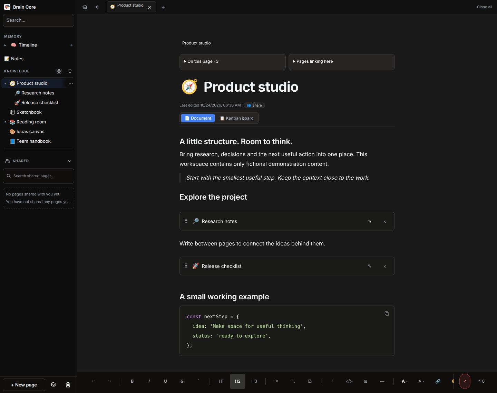
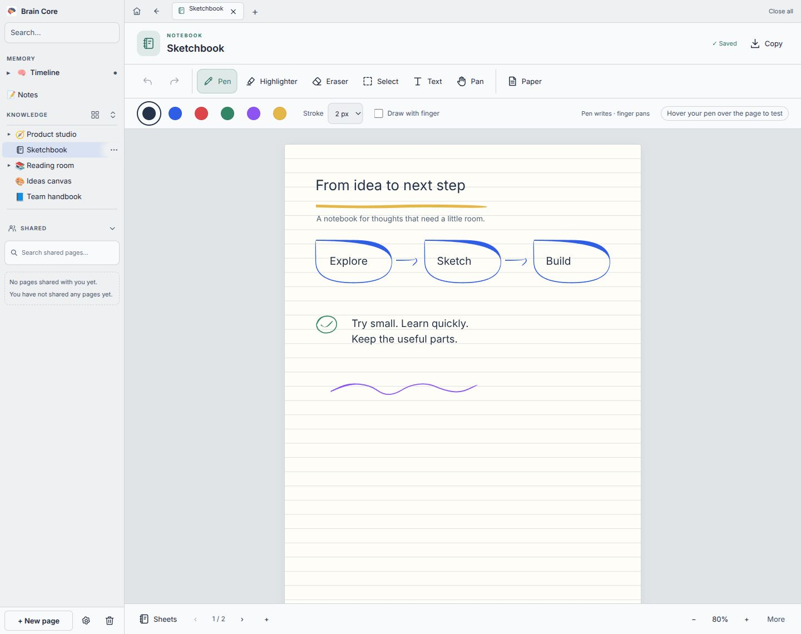
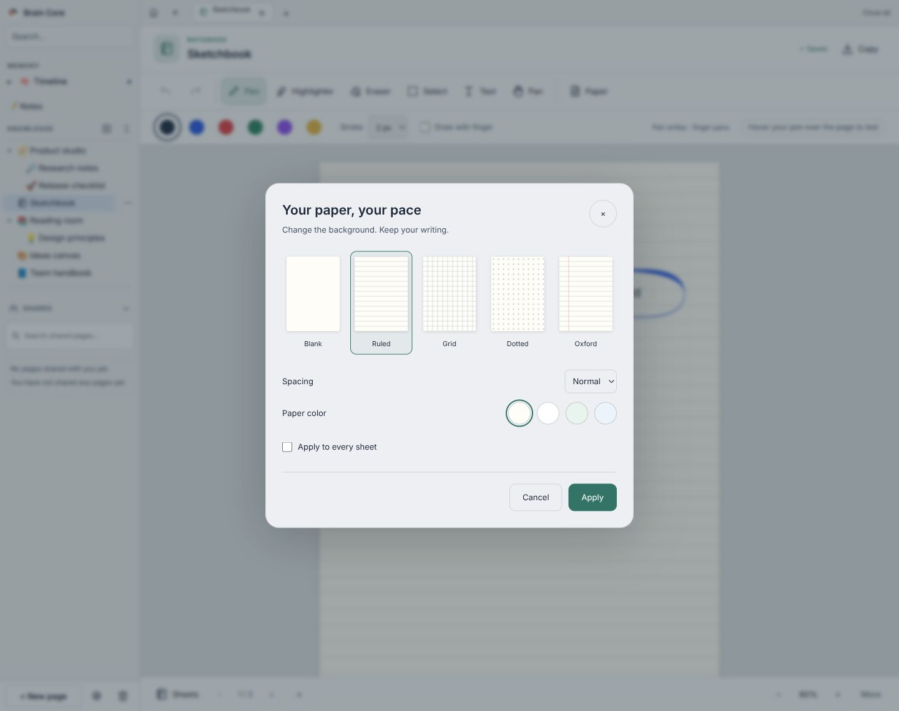
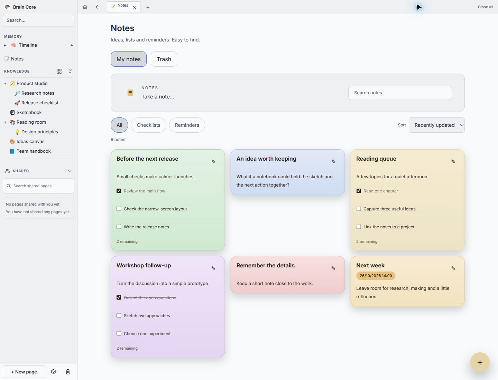
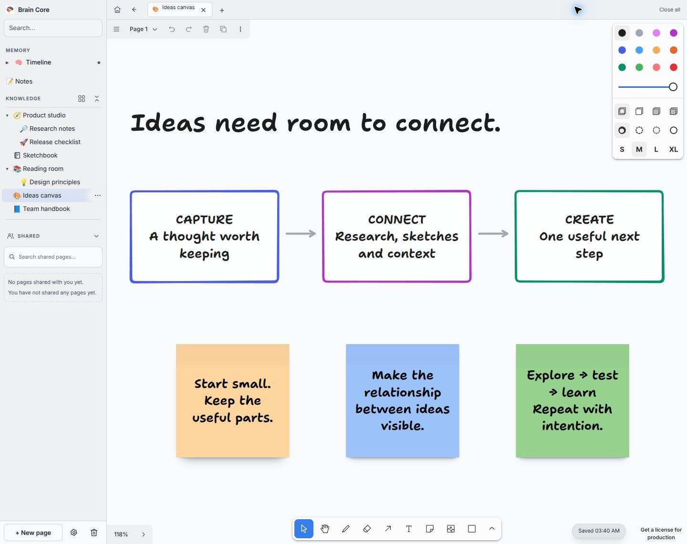
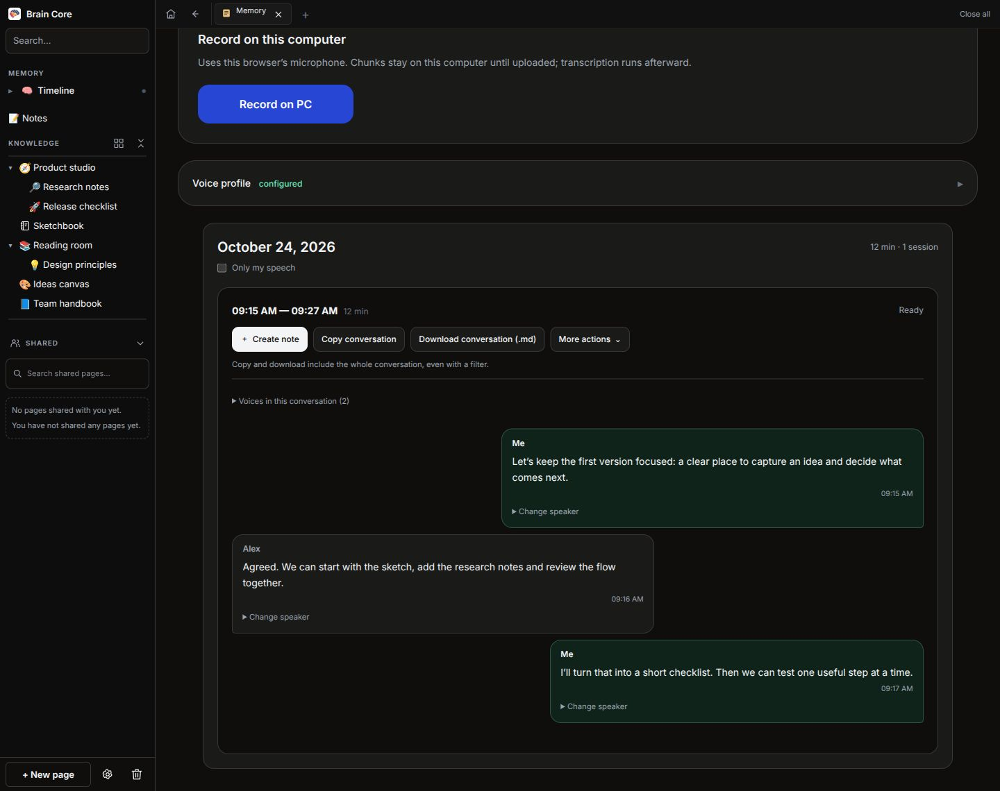
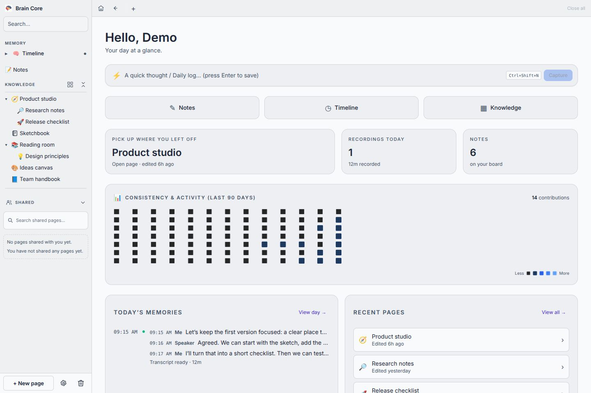
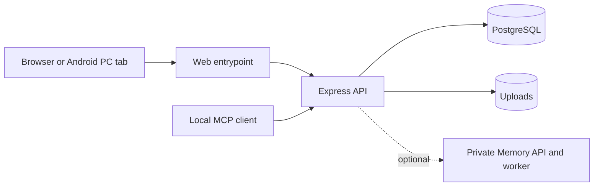

# Brain Core

**A self-hosted workspace for writing, handwriting, visual thinking and recorded memories.**

Keep a project brief, a quick checklist, a pen sketch and the conversation behind
an idea in one workspace. Brain Core combines rich-text pages, an infinite
canvas, a handwriting notebook and an optional recording/transcription pipeline.

Run it on a computer you control. Core note-taking needs no cloud account,
AI API key or GPU. Its database and uploads stay in persistent local
volumes; transcription and external AI clients are optional integrations.

[Quick start](#quick-start) · [Android app](#android-companion) ·
[Documentation](#documentation) · [Changelog](CHANGELOG.md) ·
[Contributing](CONTRIBUTING.md)



*Current web components with fictional content and English demonstration labels.
The application is primarily in Portuguese; these images do not imply complete
English localization. See [screenshot provenance](docs/SCREENSHOTS.md).*

## One workspace, several ways to think

| Surface | What it does |
| --- | --- |
| **Rich-text pages** | Format text, tables, checklists and highlighted code. Copy an entire code block with its corner icon. Organize pages and subpages in a tree; drop a card onto another card to nest it, or use its edges to reorder. Insert real text between cards. |
| **Notebook** | Write with editable vector pen/highlighter strokes and typed text boxes. Choose blank, ruled, grid, dotted or Oxford paper; use multiple sheets, selection, whole-stroke erasing, undo/redo, zoom and focus mode. |
| **Infinite** | Sketch and arrange ideas freely on a tldraw canvas, with automatic snapshot saving. Its SDK has separate production licensing requirements; see below. |
| **Quick notes** | Capture ideas, checklists and reminders on a searchable board. Toggle checklist items directly, filter and sort notes, and recover deleted notes through Undo or Trash. |
| **Knowledge and navigation** | Search page and quick-note text, browse breadcrumbs and heading outlines, follow page references, or explore the interactive knowledge graph. Expand/collapse the tree and keep work open in app tabs. |
| **Memory** | Record deliberately, then review optional local transcriptions as a conversation. Search transcripts, correct speakers, copy/download the conversation or turn it into a note or reminder. |

Start text pages from Study, Meeting or Project templates, or save a reusable
text/structure snapshot. Add supported images and documents; PDFs can be read
inside a page. Share pages with another registered account as a viewer or editor.
Light, dark and additional themes are available.

Text pages and notebooks keep account-scoped local drafts for recovery when a
save cannot finish. Revision checks prevent stale overwrites; page history and
recoverable Trash offer additional recovery paths. Browser drafts are local to
that browser and origin, and do not replace backups or make the whole app offline.

## A closer look

### Notebook: paper, ink and text



Change the paper without clearing your writing. Pinch/Ctrl+wheel zoom, sheet
navigation and focus mode help on smaller screens. Pressure and pen-button
behavior depend on the device/browser; physical S Pen behavior is not certified.
Handwriting recognition and PDF import/export are not included. Notebook
titles are searchable; ink and typed boxes are not text-indexed in this version.
[Notebook controls and limits →](docs/NOTEBOOK.md)

<details>
<summary>Choose your paper style</summary>



</details>

### Notes: small things that stay actionable



Edit a note without losing its existing tags or reminder label. Failed saves
keep the draft for retry. Reminder dates follow the device's local calendar.
[Notes and reminder behavior →](docs/NOTES.md)

### Infinite: space for the bigger picture



Use a free-form canvas when the relationship between ideas matters as much as
the words. Infinite is a separate page format from text notes and Notebook.

### Memory: revisit a conversation



Transcription requires the optional Memory API and worker. Speaker grouping and
voice-reference matches help review; a probable match is a suggestion, not a
confirmed identity. Short, noisy or overlapping speech can remain unidentified.
Copying/downloading does not send the conversation to an AI service.
[Timeline, voice review and transcription setup →](docs/REMEMBER_TIMELINE.md)

### Dashboard: pick up where you left off



Capture a thought, reopen recent work, see the day's recordings and review the
90-day activity overview from the home screen.

## Quick start

**Requirement:** Docker Engine with Docker Compose.

```bash
git clone https://github.com/lizard-wizard42/Brain_Core.git
cd Brain_Core
docker compose up --build -d
docker compose ps
```

Open [http://localhost:8080](http://localhost:8080). The one-time setup wizard
creates the administrator account. The operator can then create member accounts;
each account owns its notes, linked devices and integrations.

No `.env` file is needed for this standard installation. Compose generates the
PostgreSQL password and JWT secret once and stores them in a private local
volume. Memory and the host terminal start disabled.

For fictional starter content in a **new, empty database**, use
`SEED_DEMO_DATA=true` with the ignored `.env.docker` configuration described in
the [Docker guide](docs/DOCKER.md). The screenshots above use a separate,
isolated demonstration fixture rather than personal installation data.

## Android companion

Download the signed [Android APK](https://github.com/lizard-wizard42/Brain_Core/releases/latest/download/brain-core-android.apk)
and compare its SHA-256 with the [release notes](https://github.com/lizard-wizard42/Brain_Core/releases/latest).
The app requires **Android 7.0+**. The current source version is **1.1.5**.

- A native recorder and Timeline keep recordings in private app storage. Roughly
  two-minute `.m4a` chunks survive network loss and app restarts; a chunk is
  marked uploaded only after the server confirms its SHA-256.
- The **PC** tab opens your own web workspace, including Notebook and Infinite.
  Local Android notes are not synchronized with web notes in this version.
- Native notifications cover reminders and completed transcriptions, with a
  white Brain Core status-bar icon. Scheduling is local plus background sync,
  not Firebase push; Android permission, network and battery restrictions apply.
- Native voice review preserves server voice groups, probable owner matches and
  manual corrections. Voice references belong to the linked account.

Use [Tailscale Serve for private HTTPS access](docs/ANDROID.md), link the phone
from your account and keep the computer reachable when syncing. Device
credentials use Android Keystore. The APK contains no preconfigured server,
account, recording or service token.
[Android setup and notification limits →](android/README.md)

## Optional local transcription

The standard installation keeps Memory offline. Phone recording and local
playback work without it; server upload and transcription require the private
Memory API and worker.

Enable the [CPU transcription stack](docs/REMEMBER_TIMELINE.md) when needed, or
use the [NVIDIA GPU worker](services/gpu-worker/README.md) on compatible hardware.
Transcription runs locally with the configured model. Choose automatic,
scheduled or manual processing, pause new jobs and configure audio retention
per account. Enrolling a voice reference is optional; review suggestions before
confirming a participant.

The optional service needs its own private configuration and token. Keep it
private; it is not a public transcription endpoint. Model downloads may require
network access. No recordings, voice samples, models or transcripts are shipped
in this repository or APK.

## MCP for your AI client

Enable **MCP e acesso da IA** in Settings, then create an expiring credential with
independent read/write permissions for rich-text pages and quick notes. Revoke
one credential or all of them, or switch MCP off for the account.

The local STDIO adapter exposes **12 tools**: list/search, read, create, update,
list versions and restore, for each of the two note collections. The backend
enforces ownership and scopes. Writes use revision checks and operation IDs to
prevent stale updates and duplicate retries. The optional `brain-core-notes`
skill explains safe editing and preservation of Tiptap content.

Each credential selects one Brain Core account. Changing the browser login does
not change a running MCP connection. For separate people, use separate
credentials and separately controlled client/tunnel profiles; a ChatGPT login
alone does not select a Brain Core account.

Desktop clients can launch the local adapter. ChatGPT access through an optional
private tunnel requires separate external setup and permissions. The adapter
opens no additional listener and accepts only a loopback HTTP backend origin.
It does not expose Notebook, Infinite, audio, transcripts, terminal access or
other users' shared pages. Requested note content reaches the AI client and may
be processed by its configured provider; local storage does not prevent that.
[MCP setup, credentials and boundaries →](docs/NOTES_MCP.md)

## Data and deployment



The standard web entrypoint binds to loopback at port 8080; PostgreSQL has no
published host port. Notes, uploads and generated secrets use persistent local
volumes. Enabling Memory adds persistent storage for its recordings,
transcripts, models and index.

Back up the volumes you use. `docker compose down` stops services without
removing volumes; **`docker compose down -v` deletes persisted data**. Local
drafts and version history supplement backups rather than replacing them.

Authentication includes session cookies, login throttling, optional TOTP
and trusted-device support. For access beyond loopback, configure TLS, secure
cookies, explicit origins and trusted proxies using the deployment guides.
Obtain consent before recording others and protect recordings and backups like
the original notes.

## Development

**Web:** React 19, TypeScript, Vite, Tailwind CSS, Tiptap and tldraw.

**Server:** Node.js, Express, Socket.IO and PostgreSQL.

**Android:** Kotlin and Jetpack Compose.

See [CONTRIBUTING.md](CONTRIBUTING.md) for dependency installation, tests and
privacy checks, [AGENTS.md](AGENTS.md) for source/build rules, and the
[maintainer workflow](docs/MAINTAINER_WORKFLOW.md) for publishing. Edit source
files rather than generated bundles; `./build.sh` is the canonical web/server
build. Use fictional data for screenshots and regression tests.

## Documentation

| Topic | Guide |
| --- | --- |
| Install, update and operate Docker | [Docker](docs/DOCKER.md) |
| Text editor, navigation, templates and recovery | [Editor and page tree](docs/EDITOR_E_PAINEL.md) |
| Pen input, paper, sheets and editable copies | [Notebook](docs/NOTEBOOK.md) |
| Quick notes, checklists, reminders and Trash | [Notes](docs/NOTES.md) |
| Recording, speakers and local CPU transcription | [Timeline](docs/REMEMBER_TIMELINE.md) |
| Android and private HTTPS | [Android](docs/ANDROID.md) · [App source](android/README.md) |
| AI client connection and per-account credentials | [MCP](docs/NOTES_MCP.md) |
| Backup and restore | [Backup guide](docs/BACKUP_BRAIN_CORE.md) |
| Server and storage architecture | [Architecture](docs/ARQUITETURA.md) · [Database](docs/BANCO_DE_DADOS.md) |
| Screenshots and fictional demo content | [Screenshot notes](docs/SCREENSHOTS.md) |

For vulnerability reports, follow the private process in [SECURITY.md](SECURITY.md).
For recent changes, read [CHANGELOG.md](CHANGELOG.md).

## Support and license

If Brain Core is useful to you, [support its development](https://buymeacoffee.com/lizardwizard).
It is available under the [MIT License](LICENSE), including commercial use,
while preserving the license notice. The project name and visual identity do
not imply endorsement or affiliation.

Third-party dependencies retain their own licenses. In particular, Infinite uses
the tldraw SDK, whose [versioned license](https://github.com/tldraw/tldraw/blob/v5.1.1/LICENSE.md)
sets separate production-use and license-key requirements. Brain Core’s MIT
license does not replace those terms. The Notebook editor is a separate surface.
