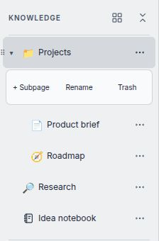
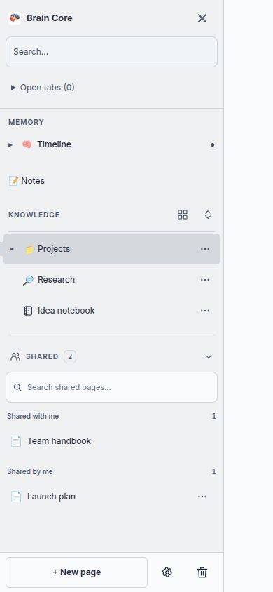

# Editor e painel inicial

## Páginas e referências

Cartões de subpáginas mostram o título sem repetir o rótulo “Subpágina”. Referências mantêm o rótulo “Referência”, pois apontam para uma página existente. Uma referência inserida com `@` aponta para uma página existente: **Remover referência** remove apenas esse bloco, sem mover a página de destino para a lixeira. A alteração do documento segue o salvamento normal do editor.

**Mover página para a lixeira** pede confirmação e só remove o bloco após a API confirmar a operação. A página pode ser restaurada pela lixeira. Se a operação falhar, o bloco permanece visível e o diálogo oferece nova tentativa.

**Renomear página** altera o título da página de destino, inclusive quando acionado numa referência. Salvar/Enter confirma, Cancelar/Escape descarta o nome digitado. Uma falha mantém o texto digitado para nova tentativa.

As ações ficam visíveis para toque e são acessíveis por teclado. O diálogo começa com foco em Cancelar, mantém Tab dentro dele e devolve o foco ao botão de origem quando fechado.

## Busca com `@`

Digite `@` e parte do título para referenciar uma página. A busca ignora acentos e espaços no início/fim; o nome da página pai ajuda a distinguir resultados com o mesmo título. Até oito resultados aparecem por vez. Quando houver mais, continue digitando para filtrar.

Use ↑/↓ para escolher, Enter para inserir e Esc para fechar. Uma busca sem resultados permanece visível com uma explicação, sem interceptar Enter ou as setas do editor. O menu se reposiciona para permanecer dentro da tela e acompanha mudanças de tamanho da janela.

## Painel inicial

**Continue daqui** abre a página mais recentemente editada. Os painéis de páginas e gravações distinguem carregamento, erro e lista vazia. **Tentar novamente** repete apenas a consulta que falhou; falha de consulta não significa ausência de conteúdo.

O status das gravações aparece em texto. Uma transcrição com erro permanece identificada como erro, mesmo que possua texto parcial. As consultas preservam o recorte de dia de São Paulo, incluindo sessões do dia seguinte em UTC.

As mudanças não exigem migração de dados nem novas variáveis de ambiente.

## Busca unificada

A busca lateral pesquisa títulos e conteúdo de páginas e notas rápidas da conta.
Resultados mostram um trecho destacado e o caminho da página; o filtro alterna
entre as duas coleções. A busca ignora maiúsculas e acentos comuns do português,
e “Carregar mais resultados” pagina os resultados em grupos de 20.

Somente o texto dos blocos do editor é pesquisado, sem atributos, URLs de anexos
ou dados internos dos canvases. Notas rápidas incluem o corpo e itens de checklist.
Páginas na lixeira e páginas de outras contas não entram nos resultados. Áudios
e transcrições continuam em sua busca própria. Um resultado de nota rápida abre
o quadro com foco na nota correspondente. Falhas oferecem nova tentativa.

## Navegação nas notas

Acima do título, o caminho permite voltar às páginas ancestrais. “Nesta página”
lista os títulos do documento e acompanha a edição; selecionar um título leva
ao trecho correspondente, inclusive quando há títulos repetidos.

“Páginas que citam esta” carrega as referências recebidas ao abrir o painel.
Fechar e abrir atualiza a lista. São consideradas as suas páginas fora da lixeira.
Uma página compartilhada não revela a estrutura privada de quem a compartilhou.

## Leitura e controles do editor

O título se ajusta à largura disponível, incluindo telas pequenas. Ações de
ícone ficam visíveis sem passar o mouse. Diálogos de tabela, subpágina e busca
seguem as cores do tema. A barra ocupa uma única linha: as ferramentas rolam horizontalmente em telas
pequenas; histórico, corretor e status de salvamento permanecem à direita.
Uma falha ao salvar o ícone mostra uma mensagem e mantém o ícone anterior.

## Modelos de notas

Na barra do editor, o botão de raio **Modelos**, ao lado de **Anexar arquivo**, abre as estruturas de Estudo, Reunião e Projeto.
Escolha um modelo, dê um título e crie uma página na raiz ou marque
**Criar dentro da página atual**. A nova nota tem conteúdo e histórico próprios.

**Salvar esta página como modelo** captura o texto e a estrutura atuais do editor,
incluindo alterações ainda não salvas na nota. Imagens, anexos e cartões de
subpáginas são removidos da cópia; tarefas ficam desmarcadas. Links de texto são
preservados. A página original não é alterada. Dê um nome único de até 80 caracteres;
o documento pode ter até 256 KB. Uma falha mantém o diálogo aberto para tentar novamente.

Modelos próprios ficam no PostgreSQL local, separados por conta, e entram no
backup completo. O backend cria a tabela `page_templates` automaticamente ao iniciar.
Os modelos prontos funcionam mesmo quando a listagem de modelos próprios falha.
Nesta versão, modelos são cópias fixas: editar uma nota criada a partir deles não
atualiza o modelo. Renomear e excluir modelos ainda não estão disponíveis.

## Expandir e recolher Conhecimento

Ao lado de **Conhecimento**, o ícone de grade abre a visão geral com cartões das
páginas principais, assim como clicar no título. O outro botão alterna entre **Expandir tudo** e
**Recolher tudo**. Ele abre todos os níveis da árvore ou recolhe todos os ramos,
inclusive o caminho da página atualmente aberta, sem trocar de página.
Quando alguns ramos estão fechados, a próxima ação é expandir tudo.

As setas individuais continuam disponíveis e o estado é lembrado neste navegador.
Selecionar outra página revela o caminho dela novamente. O botão fica desativado
quando não existem ramos com filhos. Linha do tempo e Compartilhados mantêm seus
próprios controles; esta ação não muda a organização nem o conteúdo das notas.

## Compartilhados e ações laterais

A seção **Compartilhados** pode ser recolhida pelo cabeçalho e distingue páginas
recebidas das páginas compartilhadas por você. A busca filtra as duas listas e
pode ser limpa pelo botão ao lado do campo. Cada página ocupa uma linha compacta de 44 px, com ícone e título. O título completo
aparece ao passar o mouse e no cabeçalho da página ao abri-la. Autoria, data e badges
de permissão não ocupam a lista; os detalhes de acesso continuam no painel da página.

O menu **Gerenciar acesso** permanece visível nas páginas das quais você é dono,
inclusive em telas de toque. Selecionar uma página apenas a abre; gerenciar acesso
continua sendo uma ação separada. No rodapé, **Nova página** mantém o contorno; **Configurações** e **Lixeira** usam
ícones discretos. Os três têm foco de teclado e área mínima de 44 px.
As mudanças são visuais e não alteram convites, permissões ou conteúdo das páginas.

## Consistent sidebar controls

Memory, Notes, Knowledge and Shared use compact single-line rows with 44 px
minimum height, theme-aware hover/selection colors and visible keyboard focus.
Knowledge keeps individual branch toggles, the overview grid and expand/collapse
controls. Deep nesting uses bounded indentation so titles remain readable.

Each page has a separate title button and a discreet **More actions** control.
The latter reveals **Subpage**, **Rename** and **Trash** without opening the page.
Escape closes the actions and returns focus to their trigger; clicking outside
closes them too. The page title and drag handle both support drag-and-drop.
The full title is available on hover. Trash confirmation explains recovery.

The mobile tab section retains open/close/back actions with touch-sized targets.
Search results use borderless rows and limit previews to two lines while keeping
filters, pagination and highlighted matches. Footer creation remains outlined;
settings and trash use lighter icon controls. No storage or permission changes
are required.

### Navigation previews

These previews use fictional pages and English demonstration labels. They do not
change the installation's locale.

**Page actions:** subpage creation, rename and recoverable Trash stay separate from navigation.

**Mobile navigation:** compact rows, branch controls and footer actions within a narrow drawer.

## Copying code blocks

Blocks inserted with the `</>` toolbar button or the code-block slash command
show a compact copy icon at the top right, without a header row. It copies the entire block as plain text,
including tabs, indentation and trailing line breaks. It does not copy syntax
colors, button labels or neighboring paragraphs. Each block has its own action.

The action remains visible on touch screens and read-only shared pages. A checkmark
appears briefly after a successful copy; failures show a retry message. A fallback
is attempted when the browser Clipboard API is unavailable, preserving focus and
selection. Browser restrictions can still prevent copying.

The control is editor UI only: existing code blocks, saved JSON, HTML exports,
language highlighting and editing shortcuts retain their original format. No
data migration or new dependency is required.

## Recovering unsaved text

The text editor saves a complete local draft (title and Tiptap document) in
IndexedDB when editing, before the 1.5-second server autosave delay. Draft keys
include the signed-in account and page; another account does not receive the
recovery prompt. Drafts remain in this browser and origin, rather than syncing
between devices. Clearing site data also removes them.

When reopening a page with unsent writing, the editor waits for your choice:

- **Recuperar rascunho** restores its title and content. If its base revision still
  matches the loaded page, normal autosave resumes.
- **Baixar rascunho** downloads the title, complete Tiptap content and base revision
  as JSON for safekeeping.
- **Usar versão salva** loads the current server version and discards the local
  draft. A failed server read keeps the draft and offers an error message.

If the server revision changed, restoring the draft opens it with a conflict
warning and prevents automatic overwrite. Download the draft before choosing
**Recarregar do servidor** if you want to keep both versions. The editor also
retains drafts when a live save returns a revision conflict.

A server acknowledgement removes only the matching draft. Writing made while a
save is pending stays local until its own save succeeds. Network failures leave
an error and **Tentar salvar** action; closing the view attempts a final save,
while the local draft provides recovery if that request cannot finish.

When the browser cannot read or write local storage, a warning asks you to keep
the page open until saved or download a copy. Local recovery supplements server
backups; it does not make a page available offline if the app cannot load it.
The existing Notebook and Infinite formats retain their own persistence flows.

See the [TDD evidence](TEXT_EDITOR_RECOVERY_TDD.md) for validation and limits.
